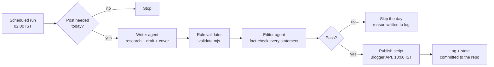

# AI Blogging Agent with Automated Fact-Checking

An agent that researches, writes and publishes one blog post a day for my business, [A&N Web Services](https://www.anwebservice.com), with no manual step. It runs on GitHub Actions. Two independent checks stand between the writer and the live blog, and a post that fails either check is not published.

Built by [Maffi Bhall](https://maffi-devi.github.io/). Live blog: [anwebservices.blogspot.com](https://anwebservices.blogspot.com/)

## Results (7 October to 21 November 2026)

| | |
| --- | --- |
| Posts published | **46**, one a day, covering 24 districts of Haryana |
| Average length | 921 words |
| Statements fact-checked by the AI editor | **740** |
| Statements removed or rewritten because no source supported them | **128** (about 17%) |
| Days with no post (the agent stopped instead of publishing) | 1 |

The 17% is the number that made this project worth building: roughly one statement in six that a capable model writes on its own is not backed by the sources it read.

## How a day runs

1. **Context** (`scripts/context.mjs`): today's date, the plan row, every topic and link already used, and whether a post already exists today. A second scheduled run later in the morning does nothing if the first one succeeded.
2. **Writer** (Claude Code, `agent/daily-run.md`): checks the topic is new, researches real search wording with at most 3 SerpApi calls, opens at least 2 reliable sources, writes `out/post.json` and makes a cover image (`scripts/make-cover.mjs`, with a stock-photo fallback and a plain brand card as the last fallback).
3. **Rule validator** (`scripts/validate.mjs`): the countable rules, such as length, title and description limits, number and position of internal links, anchors, labels and image. The writer has to run it until it reports `ok`.
4. **Editor** (a second, separate Claude run, `agent/review.md`): lists every checkable statement, opens the sources, marks each one supported, unsupported or wrong, and removes or rewrites anything unsupported. It also applies Google's helpful-content and spam policies. It writes `out/review.json` with a `pass` or `fail` verdict. See [`examples/sample-review.json`](examples/sample-review.json) for a real one.
5. **Publish** (`scripts/publish.mjs`): runs only on a pass. The first three posts went out as drafts for me to read; after that, posts are handed to Blogger's own scheduler.
6. **Log**: every day, including skipped ones, is written to the log and committed.

## Design decisions

- **Two separate model runs.** The editor does not see the writer's reasoning, only the finished post and its sources. A model checking its own work in the same context tends to agree with itself.
- **A skipped day is cheap; a wrong post is not.** Every step that is unsure fails closed.
- **Least privilege.** The writer and editor never receive the Blogger token; only the deterministic publish script does. The models get only the research and image keys they need.
- **Text from the web is data, not instructions.** Both prompts say so explicitly, to reduce prompt-injection risk from pages the agent reads.
- **Idempotent schedule.** GitHub sometimes starts scheduled runs late, so there are two daily triggers and the second one exits if today's post exists.
- **Weekly review.** On Mondays the agent reads Google Search Console data (`scripts/gsc.mjs`) to see which target pages have been crawled and how they rank.

## Repository contents

| Path | What it is |
| --- | --- |
| `workflow/daily-post.yml` | The GitHub Actions workflow (kept outside `.github/workflows` here so this showcase copy does not run) |
| `agent/daily-run.md` | Instructions for the writer run |
| `agent/review.md` | Instructions for the editor run |
| `scripts/` | Context, research (SerpApi), cover images (Cloudflare Workers AI, Pexels), validation, publishing (Blogger API) and Search Console helpers |
| `examples/sample-review.json` | A real editor verdict |
| `env.example` | Names of the keys the agent needs (values live in GitHub Secrets) |

The business brief the agent follows (company facts, services, link targets and the 30-day topic plan) is private and not included.

## Stack

Claude Code (headless), Node.js 22, GitHub Actions, SerpApi, Blogger API v3, Google Search Console API, Cloudflare Workers AI (FLUX) and Pexels for images, sharp and opentype.js for cover rendering.

## What I would add next

- A small labelled set of posts to measure the editor itself: how many unsupported statements it misses and how many supported ones it removes by mistake.
- Click and impression tracking per post from Search Console, to learn which topics actually bring enquiries.

© 2026 Maffi Bhall. All rights reserved.
